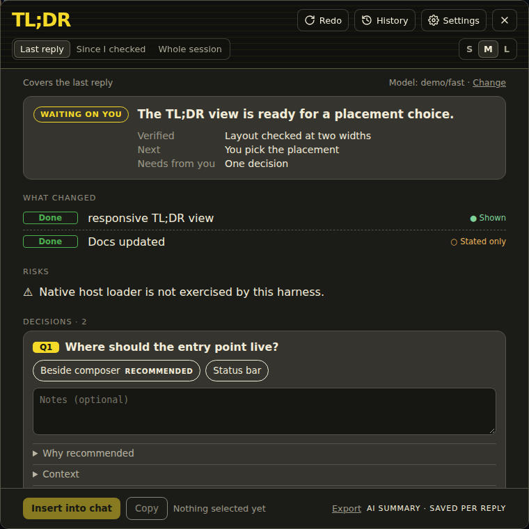
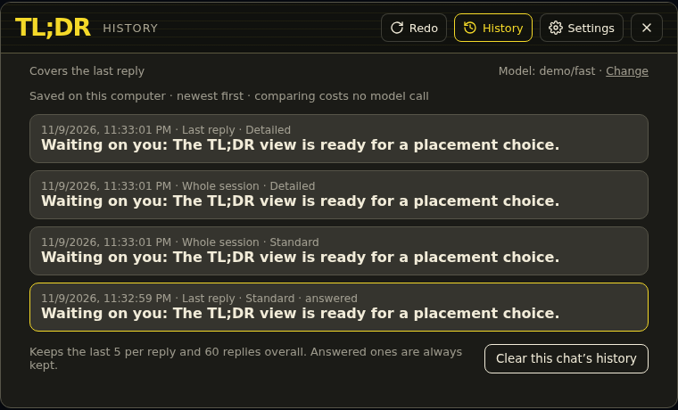
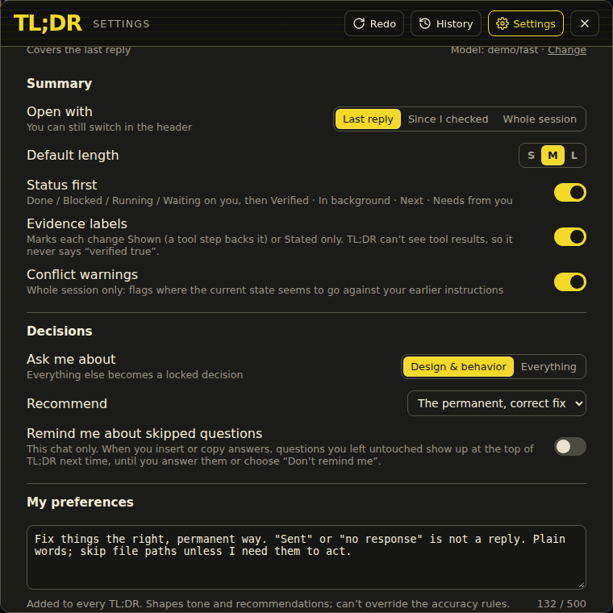
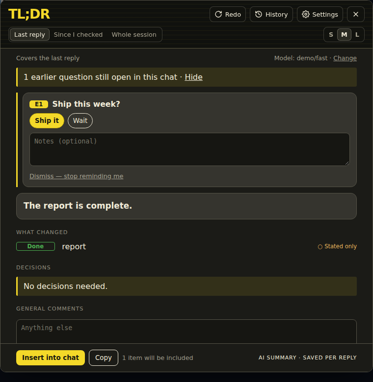
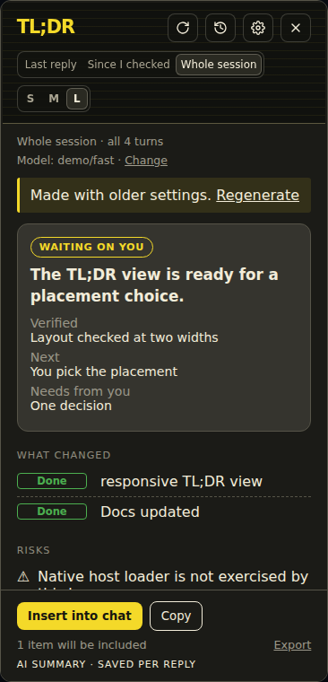

# TL;DR for Hermes

**One click turns a long agent reply into what changed, what's backed by a tool step, what's still risky, and what the agent needs from you.**



## Why

Agents write long replies. Somewhere in the middle there's usually a question you need to answer, a claim that was never checked, or a note that something is still running. TL;DR reads the reply for you and puts those things on one card, so you can answer and move on.

## What you get

Click **TL;DR** next to the chat box. The card shows:

- **Status first.** Done, Blocked, Running or Waiting on you, then what's verified, what's still running in the background, what's next and what's needed from you.
- **What changed**, with each item marked **Shown** (a tool step in the work backs it) or **Stated only** (the agent said so, but nothing in the work shows it). TL;DR can't see tool results, so it never claims something is verified true. It only shows what the work points to.
- **Risks** worth knowing before you go on.
- **Decisions.** Each question the agent left you, with options, a recommended choice, why it's recommended, and a notes box. Pick answers, then **Insert into chat** puts them in your message box, ready to review and send. **Copy** and **Export** (an HTML page of the decisions and your answers) work too.

## Choose what to summarize

- **Last reply**: just the latest response.
- **Since I checked**: everything since you last opened TL;DR in this chat.
- **Whole session**: where the whole chat stands now. Optional **conflict warnings** flag where the current state seems to go against what you asked for earlier.

Pick a length with **S / M / L**: a glance, standard, or detailed.



Every summary is saved per reply. **History** shows earlier summaries for the chat, and **Redo** writes a fresh one (one model call). If you change settings, older summaries say so and offer **Regenerate**.

## Settings



- Default length and what to summarize by default
- Evidence labels, conflict warnings and status-first layout, each on or off
- **Remind me about skipped questions**: questions you left unanswered show up at the top next time, for this chat only
- **My preferences**: up to 500 characters of standing instructions for how summaries are written (for example, "plain words, skip file paths")
- **Automatic TL;DR** (off by default): summarize replies longer than a length you choose in the background, with a daily limit (default 30) so it can't run up your usage



## Choosing the model

TL;DR registers its own helper task, **TL;DR**, in Hermes. It uses **Automatic** (your Hermes default) unless you pick a model for it in **Settings → Models → Auxiliary → TL;DR**. The **Model: … · Change** link in the card opens that screen. Your main chat model is not affected, so you can point TL;DR at a small, fast, cheap model.

## Works on narrow windows too



## Install

From Hermes Desktop: **Capabilities → Plugins**, search for **TL;DR**, then **Install**.

From the command line:

```sh
hermes plugins install tldr
```

TL;DR is one package with two halves: the Desktop button and card, and a small backend on your Hermes server that reads the chat and calls the model. The installer handles both, including when Desktop is connected to a remote gateway. Enable it when asked.

## Privacy and what it touches

- **Model calls:** only when you click (or when you turn on Automatic TL;DR), through Hermes's own auxiliary-model routing (`ctx.llm.complete` with the `tldr_summary` task). It sends the chat text in the scope you chose (capped at about 32,000 characters of reply plus limited recent context), tool names from the work, and your preferences text. It goes to whichever provider you've set for the TL;DR task. Nothing else is contacted. No telemetry.
- **Reads:** the selected chat's history from this Hermes profile's session database, read-only.
- **Writes:** summaries, your answers and settings are kept in the Desktop plugin storage on your computer. You can delete them for a chat from History.
- **No credentials** are handled by the plugin. Hermes does the model call with its own configured keys.
- **No shell commands, no background services.** Each model call runs on a short-lived worker thread inside Hermes's backend while that request is in flight.

## Compatibility

- Hermes Agent **0.23.0** or newer, with **Hermes Desktop**.
- Desktop on the same machine as Hermes, or connected to a remote gateway.

## License

MIT © 2026 Shawn Cleta
